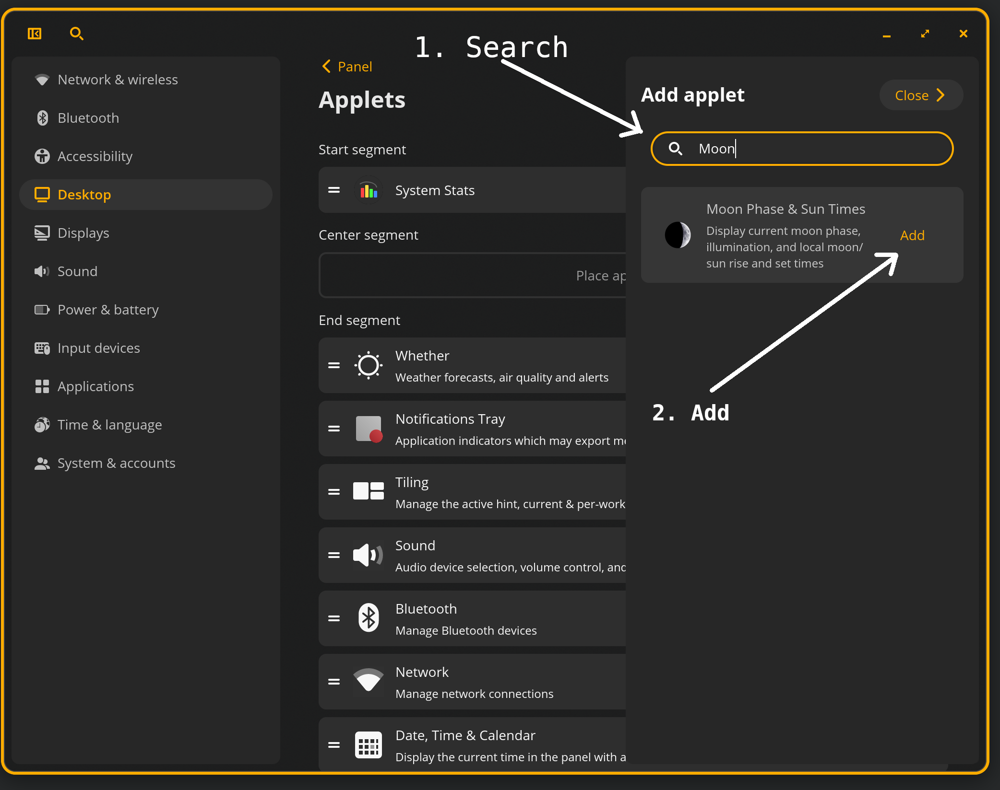

# Moon Phase (for COSMIC Desktop Environment)

A lightweight, 100% offline panel applet for the [COSMIC Desktop Environment](https://system76.com/cosmic) that displays the current lunar phase, illumination, upcoming moon events, and local moon/sun rise and set times. I built this for myself since there was nothing out there free and simple to use. Enjoy.

<p align="center">
  
</p>

<p align="center">
  
</p>

<p align="center">
  
</p>


## Features

- **Live Panel Icon:** Displays the current day of the lunar cycle (`1–29`) directly in your COSMIC panel/dock.
- **High-Precision Ephemeris Math:** Built-in pure-Rust implementation of Jean Meeus's *Astronomical Algorithms*—no external web APIs or internet connection required.
- **Moon Phase & Illumination:** Shows current phase name, illumination percentage, lunar age, and countdown to the next Full Moon or New Moon.
- **Today & Tomorrow Horizon Times:** Calculates local moonrise, moonset, sunrise, and sunset times for both today and tomorrow.
- **Intuitive Distance Metrics:** Displays Earth–Moon and Earth–Sun distances in kilometers as well as how many Moons, Earths, or Suns fit in the gap between them.
- **Automatic or Manual Location:** Automatically detects your OS timezone and coordinates from bundled IANA timezone data (`zone1970.tab` & `iso3166.tab`), or lets you search and select any city worldwide in its own local timezone.
- **Desktop Notifications:** Optional native COSMIC desktop notifications ahead of upcoming New and Full Moons, configurable from `1 hour` up to `14 days` in advance.

## Installation (Pop!_OS / Ubuntu / Debian)

1. Download the latest `.deb` package from here [cosmic-applet-moon_amd64.deb](https://github.com/gavril-amarant/cosmic-applet-moon/releases/latest/download/cosmic-applet-moon_amd64.deb) or choose an older version from [Releases](https://github.com/gavril-amarant/cosmic-applet-moon/releases) page.
2. Install it via terminal (or double-click the `.deb` file to open it in COSMIC Store):
   ```bash
   sudo apt install ./cosmic-applet-moon_*_amd64.deb
   ```
3. Open **COSMIC Settings** → **Desktop** → **Panel** (or **Dock**).
<p align="center">
  
</p>

4. Scroll down and click <b>Configure panel applets</b> (or <b>Add applet</b>).
<p align="center">
  
</p>
<p align="center">
  
</p>
5. Select <b>Moon Phase</b> from the list and place it in your preferred panel section (Left, Center, or Right).
<p align="center">
  
</p>

<p align="center">
  
</p>

## Uninstalling

```bash
sudo apt remove cosmic-applet-moon
```

---
# For Developers:
## Building from Source (Other Linux Distributions)

For Fedora, Arch Linux, or other distributions using COSMIC:

### Dependencies

- **Fedora:** `sudo dnf install cargo rust just libxkbcommon-devel wayland-devel pkgconf-pkg-config`
- **Arch Linux:** `sudo pacman -S rust just libxkbcommon wayland pkgconf`

### Build & Install

```bash
git clone https://github.com/gavril-amarant/cosmic-applet-moon.git
cd cosmic-applet-moon
sudo just install-system
```

To uninstall:

```bash
sudo just uninstall-system
```

## License

This project is open source—see the `LICENSE` file for details.
