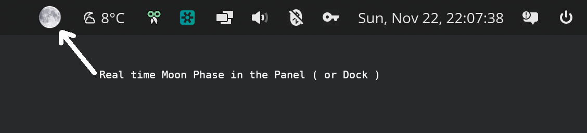
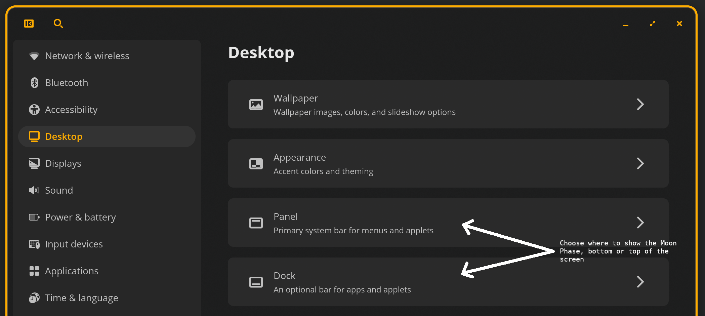
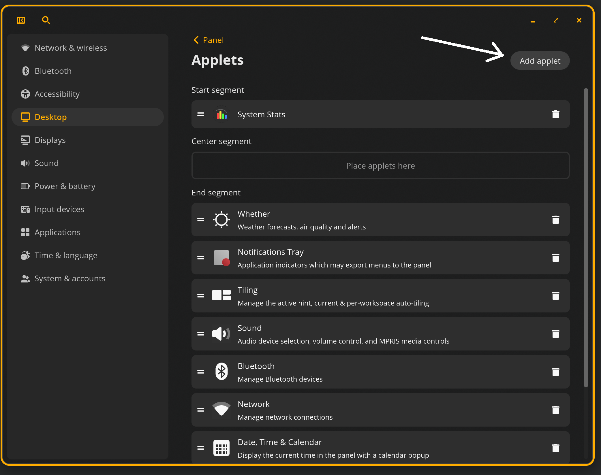

# Moon Phase (for COSMIC Desktop Environment)


A lightweight, 100% offline panel applet for the [COSMIC Desktop Environment](https://system76.com/cosmic) that displays the current lunar phase, illumination, upcoming moon events, and local moon/sun rise and set times. I built this for myself since there was nothing out there free and simple to use. Enjoy.

<p align="center">
  
</p>

<p align="center">
  
</p>

<p align="center">
  
</p>

## Contents

- [Features](#features)
- [Installation](#installation)
  - [Step 1 - Install the applet](#step-1---install-the-applet)
  - [Step 2 - Show the applet in your Panel or Dock](#step-2---show-the-applet-in-your-panel-or-dock)
- [Uninstalling](#uninstalling)
- [Building from Source](#building-from-source)
  - [Dependencies](#dependencies)
  - [Build \& Install](#build--install)
    - [Option 1 - Install on any distro](#option-1---install-on-any-distro)
    - [Option 2 - Instal only for Debian / Ubuntu / Pop!\_OS](#option-2---instal-only-for-debian--ubuntu--pop_os)


## Features

- **Live Panel Icon:** Displays real-time moon phase directly in your panel/dock.
- **Desktop Notifications:** Reminds you before Full and New moons using system notifications configurable from `1 hour` up to `14 days` in advance.
- **Moon Phase & Illumination:** Shows current phase name, illumination percentage, lunar age, and countdown to the next Full Moon or New Moon.
- **Today & Tomorrow Horizon Times:** Calculates local moonrise, moonset, sunrise, and sunset times for both today and tomorrow.
- **Intuitive Distance Metrics:** Displays Earth–Moon and Earth–Sun distances in kilometers as well as how many Moons, Earths, or Suns fit in the gap between them.
- **Automatic or Manual Location:** Automatically detects your OS timezone and coordinates from bundled IANA timezone data (`zone1970.tab` & `iso3166.tab`), or lets you search and select any city worldwide in its own local timezone.

## Installation 
### Step 1 - Install the applet
- **Pop!_OS / Ubuntu / Debian:**
    - Download **[cosmic-applet-moon_amd64.deb](https://github.com/gavril-amarant/cosmic-applet-moon/releases/latest/download/cosmic-applet-moon_amd64.deb)**.
    - Double-click the downloaded file and click **Install**. 
    Or open the **terminal** and execute:
       ```bash
       sudo apt install --reinstall ~/Downloads/cosmic-applet-moon_amd64.deb
       ```
- **Fedora:**
  ```bash
  sudo dnf install just
  git clone --depth 1 https://github.com/gavril-amarant/cosmic-applet-moon.git /tmp/cosmic-applet-moon
  cd /tmp/cosmic-applet-moon
  just install
  rm -rf /tmp/cosmic-applet-moon   
  ```
- **Arch Linux:**
  ```bash
  sudo pacman -S just   
  git clone --depth 1 https://github.com/gavril-amarant/cosmic-applet-moon.git /tmp/cosmic-applet-moon
  cd /tmp/cosmic-applet-moon
  just install
  rm -rf /tmp/cosmic-applet-moon   
  ```

### Step 2 - Show the applet in your Panel or Dock
1. Open **COSMIC Settings** → **Desktop** → **Panel** (or **Dock**).
<p align="center">
  
</p>

2. Scroll down and click <b>Configure panel applets</b> (or <b>Add applet</b>).
<p align="center">
  
</p>
<p align="center">
  
</p>
3. Select <b>Moon Phase</b> from the list and place it in your preferred panel section (Left, Center, or Right).
<p align="center">
  
</p>

<p align="center">
  
</p>

## Uninstalling
- **Pop!_OS / Ubuntu / Debian**
  ```bash
  sudo apt remove -y cosmic-applet-moon
  ```

- **Fedora / Arch / Pop!_OS / Ubuntu / Debian**
  ```bash
  rm -f ~/.local/bin/cosmic-applet-moon
  rm -f ~/.local/share/applications/io.github.gavril_amarant.cosmic-applet-moon.desktop
  rm -f ~/.local/share/icons/hicolor/128x128/apps/io.github.gavril_amarant.cosmic-applet-moon.png
  gtk-update-icon-cache -f -t ~/.local/share/icons/hicolor 2>/dev/null || true   
  ```

Note: if the applet is running, it will still be there until you restart/relogin or remove it by hand from settings.

---
# For Developers

## Building from Source

### Dependencies

- **Pop!_OS / Ubuntu / Debian:**
  ```bash
  sudo apt install cargo rustc just libxkbcommon-dev libwayland-dev pkg-config
  ```
- **Fedora:**
  ```bash
  sudo dnf install cargo rust just libxkbcommon-devel wayland-devel pkgconf-pkg-config
  ```
- **Arch Linux:**
  ```bash
  sudo pacman -S rust just libxkbcommon wayland pkgconf
  ```

### Build & Install

```bash
git clone https://github.com/gavril-amarant/cosmic-applet-moon.git
cd cosmic-applet-moon
```
#### Option 1 - Install on any distro

```bash
just install
```

#### Option 2 - Instal only for Debian / Ubuntu / Pop!_OS

```bash
cargo install cargo-deb
cargo deb
sudo apt install  --reinstall ./target/debian/cosmic-applet-moon_*_amd64.deb
```
