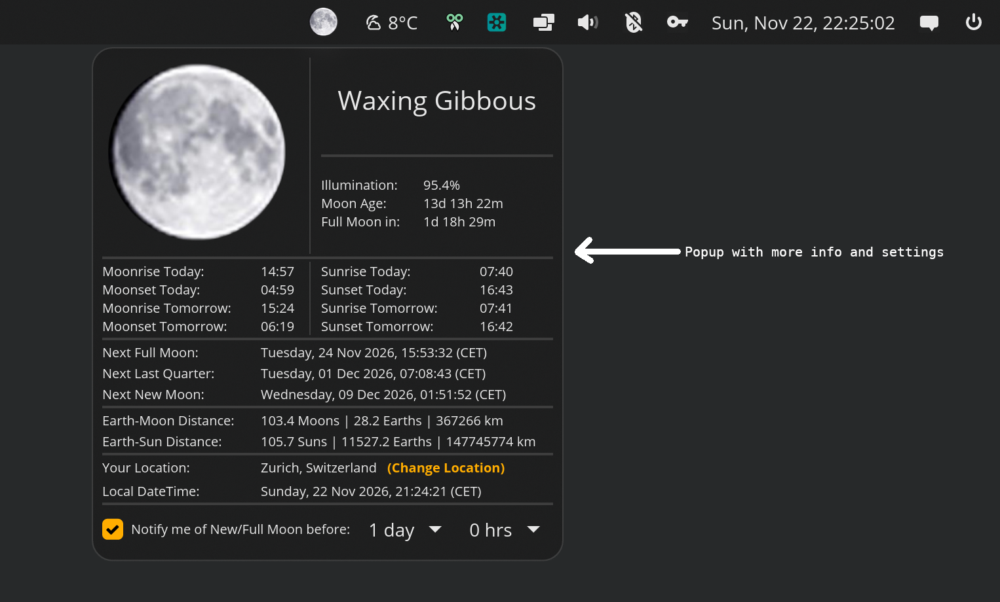
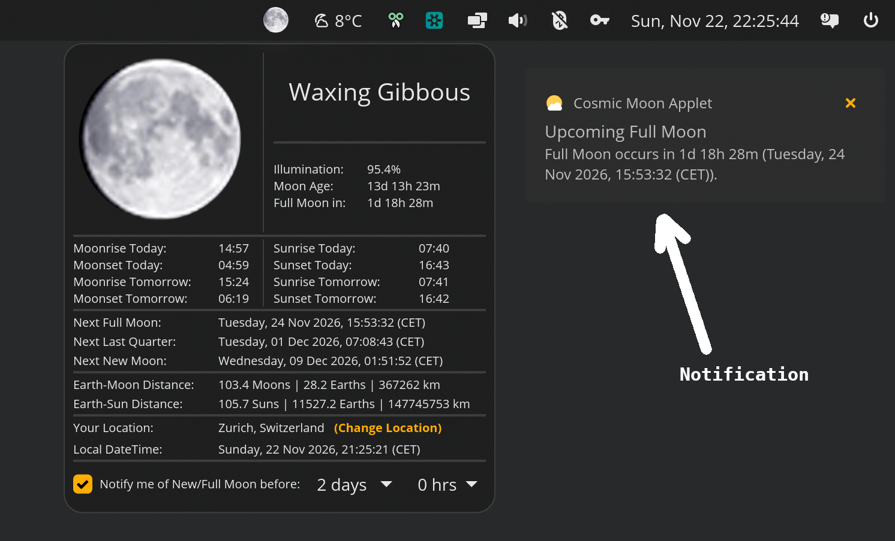
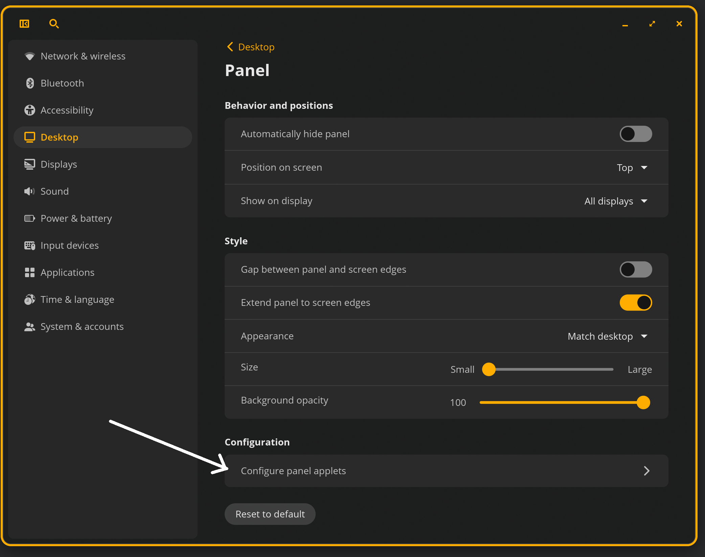
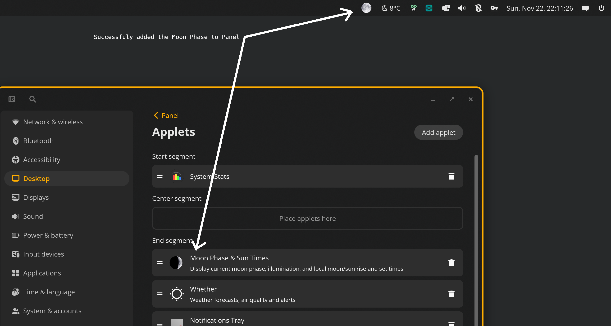

# Moon Phase (for COSMIC Desktop Environment)

## Contents
- [Features](#features)
- [Installation (Pop!_OS / Ubuntu / Debian)](#installation-pop_os--ubuntu--debian)
  - [Step 1. Download and install the applet](#step-1-download-and-install-the-applet)
  - [Step 2. Show the applet in your Panel or Dock](#step-2-show-the-applet-in-your-panel-or-dock)
- [Uninstalling](#uninstalling)
- [For Developers](#for-developers)
  - [Building from Source](#building-from-source)
    - [Dependencies](#dependencies)
    - [Build & Install](#build--install)
    - [Building a `.deb` Package Locally (Debian / Ubuntu / Pop!_OS)](#building-a-deb-package-locally-debian--ubuntu--pop_os)


A lightweight, 100% offline panel applet for the [COSMIC Desktop Environment](https://system76.com/cosmic) that displays the current lunar phase, illumination, upcoming moon events, and local moon/sun rise and set times. I built this for myself since there was nothing out there free and simple to use. Enjoy.

<p align="center">
  
</p>

<p align="center">
  
</p>

<p align="center">
  
</p>


## Features

- **Live Panel Icon:** Displays real-time moon phase directly in your panel/dock.
- **Desktop Notifications:** Reminds you before Full and New moons using system notifications configurable from `1 hour` up to `14 days` in advance.
- **Moon Phase & Illumination:** Shows current phase name, illumination percentage, lunar age, and countdown to the next Full Moon or New Moon.
- **Today & Tomorrow Horizon Times:** Calculates local moonrise, moonset, sunrise, and sunset times for both today and tomorrow.
- **Intuitive Distance Metrics:** Displays Earth–Moon and Earth–Sun distances in kilometers as well as how many Moons, Earths, or Suns fit in the gap between them.
- **Automatic or Manual Location:** Automatically detects your OS timezone and coordinates from bundled IANA timezone data (`zone1970.tab` & `iso3166.tab`), or lets you search and select any city worldwide in its own local timezone.

## Installation (Pop!_OS / Ubuntu / Debian)
### Step 1. Download and install the applet
1. Download **[cosmic-applet-moon_amd64.deb](https://github.com/gavril-amarant/cosmic-applet-moon/releases/latest/download/cosmic-applet-moon_amd64.deb)**.
2. Double-click the downloaded file and click **Install**. 
Or open the **terminal** and execute:
   ```bash
   sudo apt install --reinstall ~/Downloads/cosmic-applet-moon_amd64.deb
   ```

### Step 2. Show the applet in your Panel or Dock
1. Open **COSMIC Settings** → **Desktop** → **Panel** (or **Dock**).
<p align="center">
  
</p>

2. Scroll down and click <b>Configure panel applets</b> (or <b>Add applet</b>).
<p align="center">
  
</p>
<p align="center">
  
</p>
3. Select <b>Moon Phase</b> from the list and place it in your preferred panel section (Left, Center, or Right).
<p align="center">
  
</p>

<p align="center">
  
</p>

## Uninstalling
Open **terminal** and execute: 
```bash
sudo apt remove cosmic-applet-moon
```
Note: if the applet is running, it will still be there until you restart/relogin or remove it by hand from settings.

---
# For Developers

## Building from Source

### Dependencies

- **Pop!_OS / Ubuntu / Debian:**
  ```bash
  sudo apt install cargo rustc libxkbcommon-dev libwayland-dev pkg-config
  ```
- **Fedora:**
  ```bash
  sudo dnf install cargo rust libxkbcommon-devel wayland-devel pkgconf-pkg-config
  ```
- **Arch Linux:**
  ```bash
  sudo pacman -S rust libxkbcommon wayland pkgconf
  ```

### Build & Install

```bash
git clone https://github.com/gavril-amarant/cosmic-applet-moon.git
cd cosmic-applet-moon
```

### Building a `.deb` Package Locally (Debian / Ubuntu / Pop!_OS)

```bash
cargo install cargo-deb
cargo deb
sudo apt install  --reinstall ./target/debian/cosmic-applet-moon_*_amd64.deb
```
